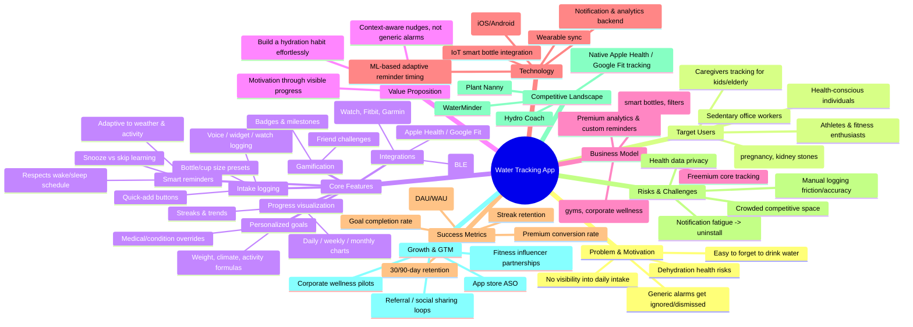

# Water Tracking App — Mindmap

> Brainstorm/groundwork artifact. Feeds into `strategic-map.md` and `problem-hook.md`.

## Outline (plain-text backup)

- **Problem & Motivation**: dehydration risk, forgetfulness, no visibility, ignored generic alarms
- **Target Users**: health-conscious, athletes, medical-need users, office workers, caregivers
- **Core Features**: logging, smart reminders, personalized goals, progress visualization, gamification, integrations
- **Value Proposition**: effortless habit-building, context-aware nudges, motivation via data
- **Business Model**: freemium, premium subscription, B2B2C, affiliate
- **Technology**: mobile app, wearables, IoT bottles, notification/analytics backend, ML timing
- **Success Metrics**: logging consistency, streak retention, goal completion, premium conversion, 30/90-day retention
- **Risks**: notification fatigue, logging friction, competition, data privacy
- **Competitive Landscape**: WaterMinder, Hydro Coach, Plant Nanny, native OS health apps
- **Growth & GTM**: ASO, influencer partnerships, corporate wellness pilots, referrals
